# Zecasino

A private casino on Zcash testnet: shielded deposits in, shielded withdrawals out, and games you can verify yourself.

**Why it exists:** no Zcash casino we know of accepts shielded deposits today. They take transparent ZEC, which puts your gambling on a public ledger. Zecasino is built shielded-only.

ZECATHON 2026, Wildcard track. Testnet only (TAZ). *Not affiliated with ZKasino.*

**Live demo:** https://zecasino.fly.dev · **Demo video:** [zecasino-demo.mp4](https://github.com/AshThunder/zecasino/releases/download/v1.0-zecathon/zecasino-demo.mp4) (2 min, from the [v1.0-zecathon release](https://github.com/AshThunder/zecasino/releases/tag/v1.0-zecathon))

**Free testnet TAZ:** [faucet.testnet.valargroup.dev](https://faucet.testnet.valargroup.dev) (public Zcash testnet faucet; TAZ has no real value)

[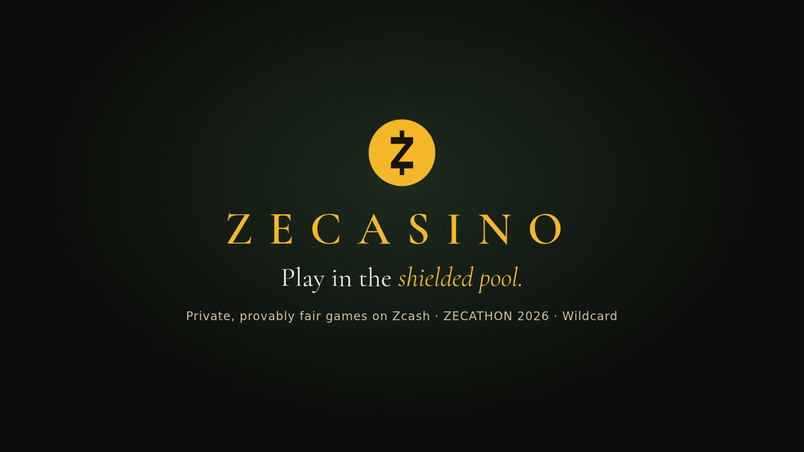](https://github.com/AshThunder/zecasino/releases/download/v1.0-zecathon/zecasino-demo.mp4)

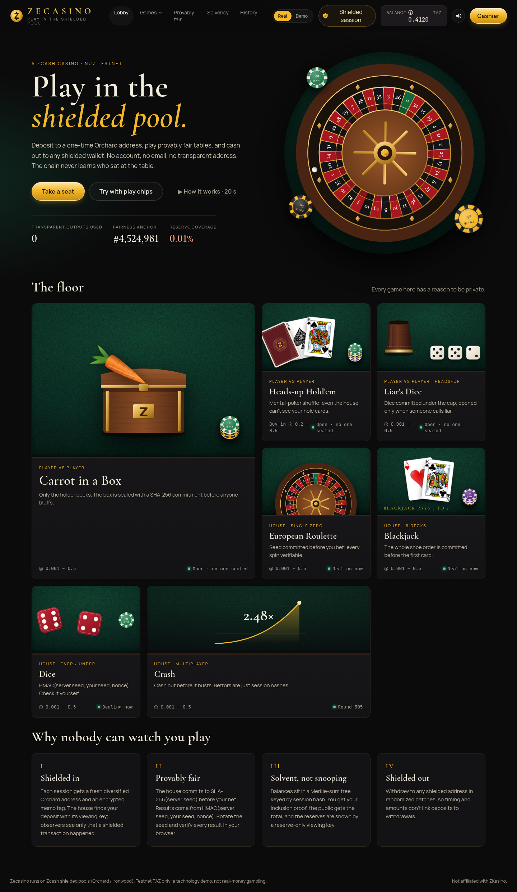

## What it is
A web casino with seven games. You get a session, make one shielded deposit, and play against your balance. No account, email or wallet connection. Bets settle instantly off-chain; only the deposit and the withdrawal touch the chain.

## The games and how winners are chosen
Every result comes from a secret seed. The server publishes its hash before you bet, reveals the seed afterwards, and your browser recomputes the result.

**Against the house**
- **Dice:** choose a target and over/under. Lower odds pay more. The seeded roll decides.
- **Roulette:** European single-zero wheel, standard bets and odds. The seed picks the pocket.
- **Blackjack:** the seed shuffles the shoe. Standard rules, including splits. The dealer's hole card stays on the server until the hand ends.
- **Crash:** the bust point (capped at 1000×) is fixed by the seed before the round. Cash out before the bust to win stake × multiplier.

**Against other players** (2% rake, stakes escrowed until settlement; stalling forfeits)
- **Carrot in a Box:** one player can peek at their box and bluffs; the other decides whether to swap. Whoever holds the carrot wins. The carrot position is committed before anyone acts.
- **Liar's Dice:** hidden dice, rising bids, "liar" reveals all. A true bid means the caller loses; a false one means the bidder loses. Dice are committed at the start.
- **Hold'em:** heads-up no-limit. The deck is shuffled with mental poker (below), so no one, including the house, knows the order, and only your browser can open your hole cards.

## Privacy model
- **One-time Orchard deposit address per session.** Orchard-only unified address, never reused; deposits are matched with the viewing key and a memo tag.
- **Shielded-only withdrawals.** Transparent addresses are rejected. Withdrawals are queued and paid in batches after a random delay (default 5–60 min, optional up to 6 h, or immediate) to weaken deposit/withdraw timing links.
- **No accounts, no IP logging, no analytics, no third-party CDNs or fonts.** A session key in your browser is the only identity; you can copy it to restore a session.
- **Transparent-inputs feature is off** in the wallet code, and we never query transparent address history (the light client fetches only our own txids).
- **What the chain sees:** Orchard transactions with hidden amounts, addresses and memos. Each table shows this in a "what the chain sees" panel.

| Party | Learns | Does not learn |
|---|---|---|
| Chain observer | that Orchard txs exist | who deposits, amounts, bets, payouts |
| Other players | public table actions, showdown cards | your address, balance, hole cards |
| House server | session balance, bets, withdrawal destination | your identity, your hole cards, links between sessions |
| Network observer | that your IP visits the site | bets (TLS); use Tor for more |

## Provable fairness
- **Commit-reveal:** HMAC-based seed commitment published before each round (`crates/fairness`). The browser re-derives the outcome after the reveal (`apps/web/src/lib/fair.ts`, checked against Rust test vectors) and shows a Verified badge.
- **Mental-poker Hold'em:** each player's browser and the house shuffle and encrypt the deck in turn (`crates/mental-poker`). Each browser verifies every shuffle, and a card can only be opened with the cooperation of all parties, so hole cards stay with their owner. Withholding keys to hide a losing hand forfeits the pot.
- **Private history:** your past rounds and their proofs are stored only in your browser. You can re-verify or clear them.

## Solvency
- **Liabilities:** a Merkle-sum tree over all session balances. Each player can check their balance is included in the published root.
- **Reserves:** a separate cold reserve wallet whose **viewing key is published on /solvency**. Anyone can load it into a wallet and see the balance. It cannot spend. The reserve seed is kept offline, and the service never reads it.

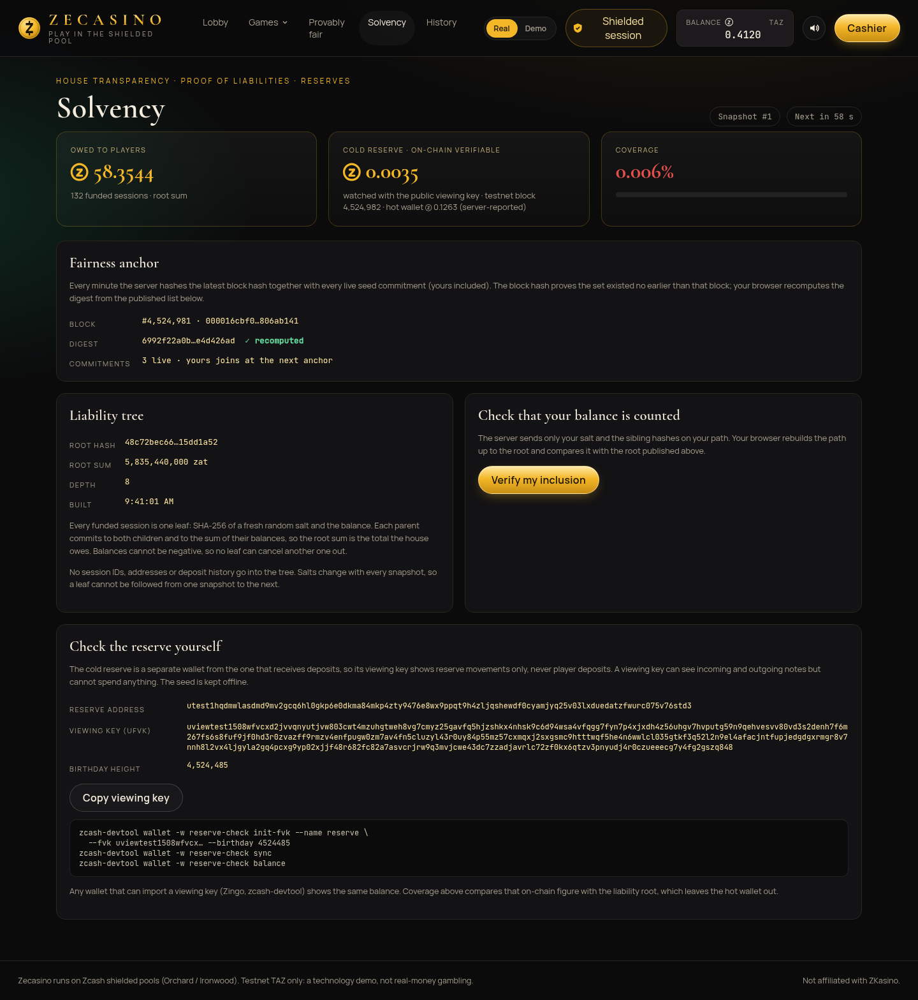

## Architecture
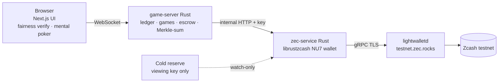

## Real testnet evidence
| What | Transaction |
|---|---|
| Shielded deposit, 0.01 TAZ, credited to a session | [bac767c3…9802b](https://testnet.zcashexplorer.app/transactions/bac767c36b188249339c72d324be2c1297a7b6191b304b3dfa59c3c557c9802b) |
| Shielded withdrawal, 0.005 TAZ, via the cashier | [5e4b9613…c3fc66](https://testnet.zcashexplorer.app/transactions/5e4b96139c7e775044611a7db8e964198b656da599e4a787322aeac6e2c3fc66) |
| Hot wallet → cold reserve, 0.05 TAZ | [abdf1a99…a60926](https://testnet.zcashexplorer.app/transactions/abdf1a996ffd63d3031a8a289f119f153370d9338aa88b0a7f124b0deba60926) |

The explorer shows the transactions exist but cannot show amounts or addresses. That is the point.

## Screenshots
| | |
|---|---|
| 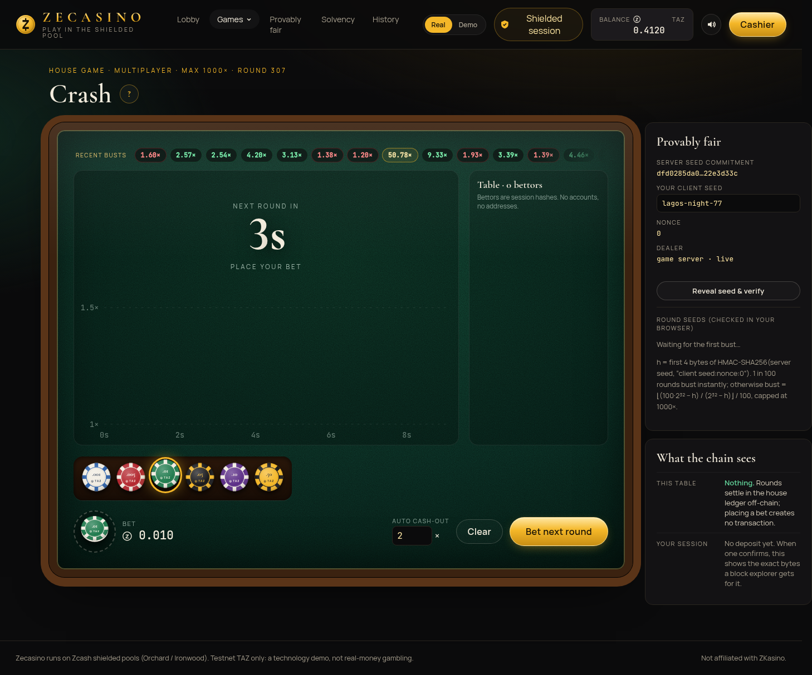 | 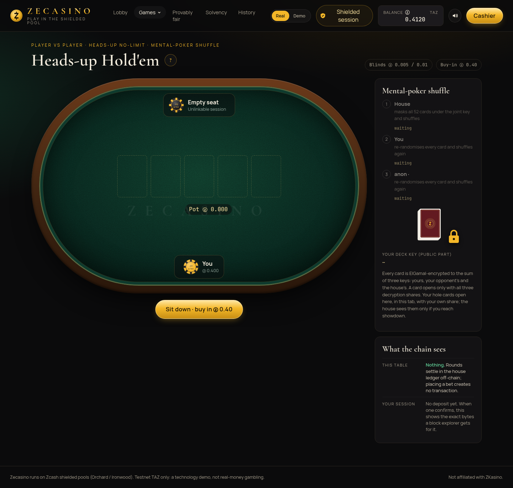 |
| 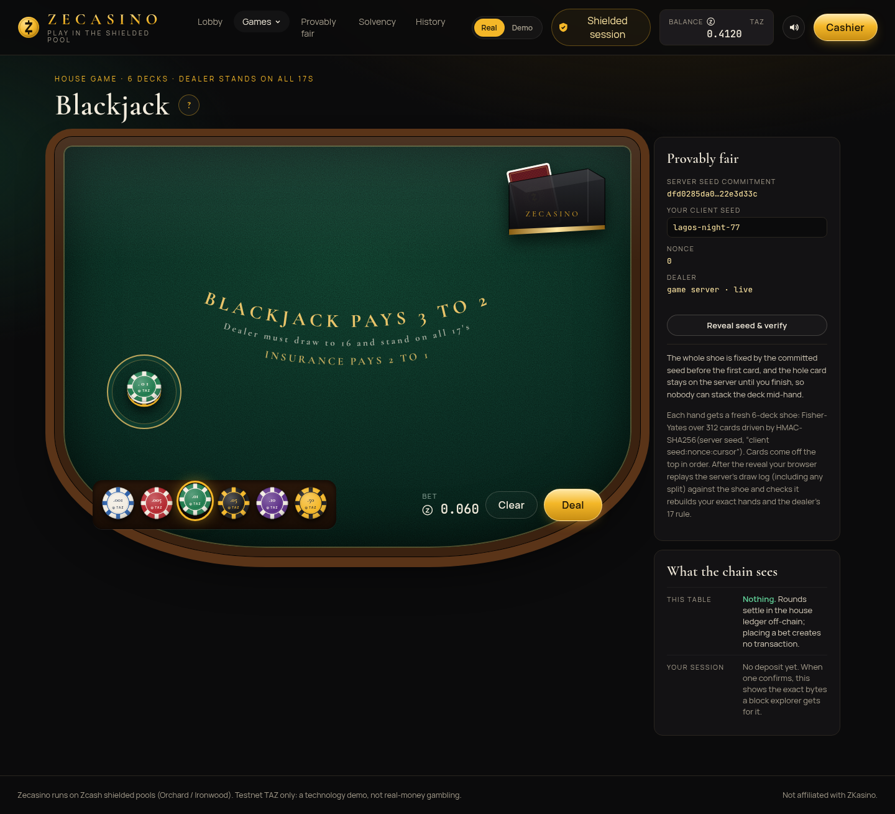 | 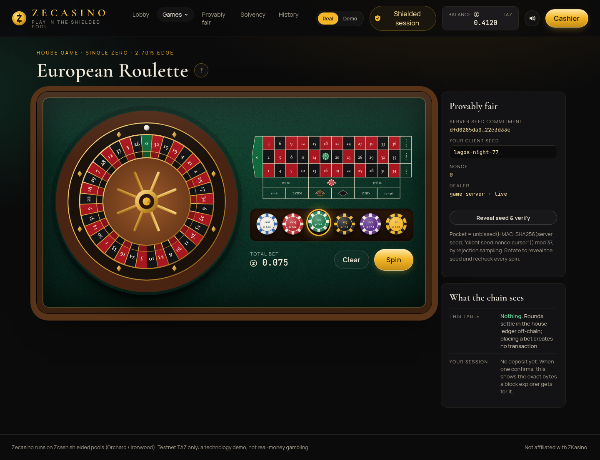 |
| 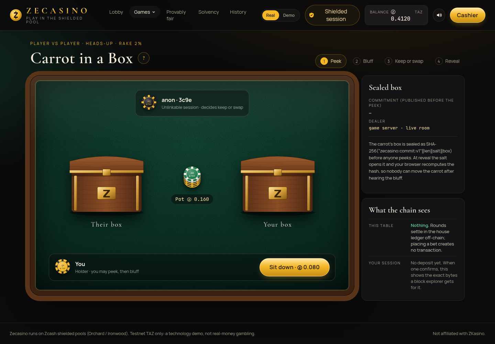 | 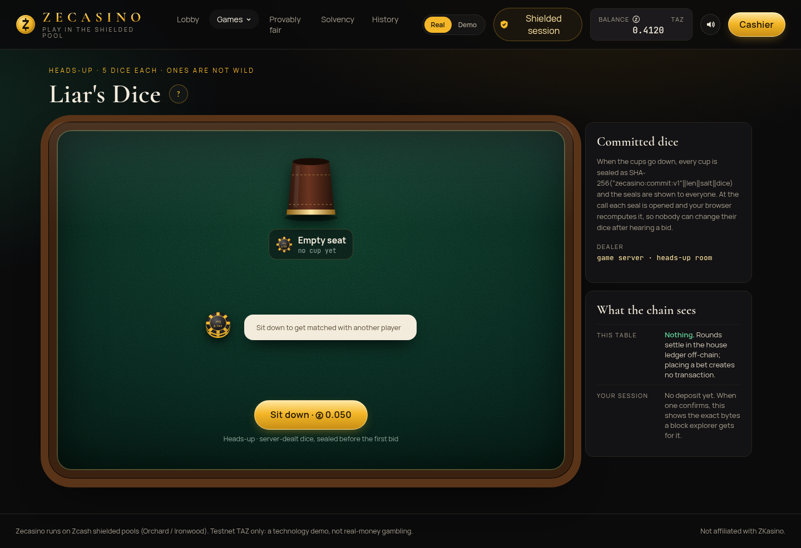 |
| 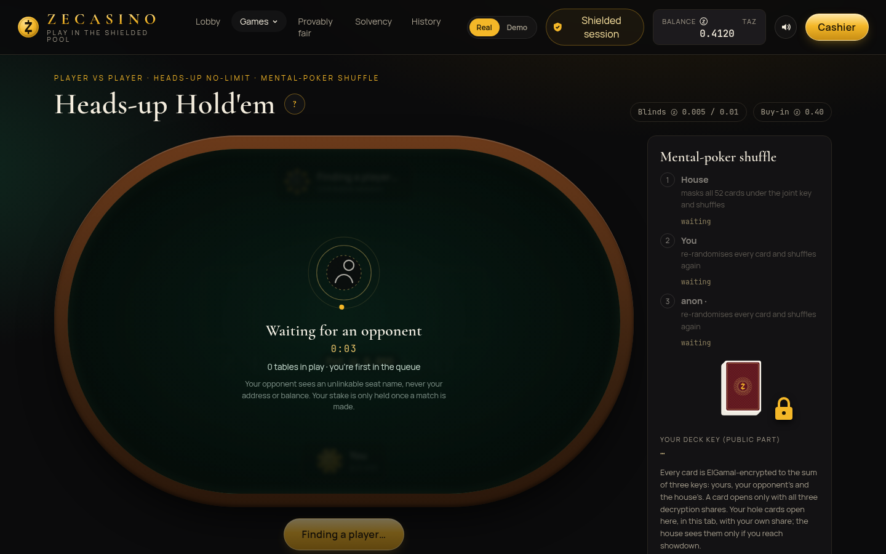 | 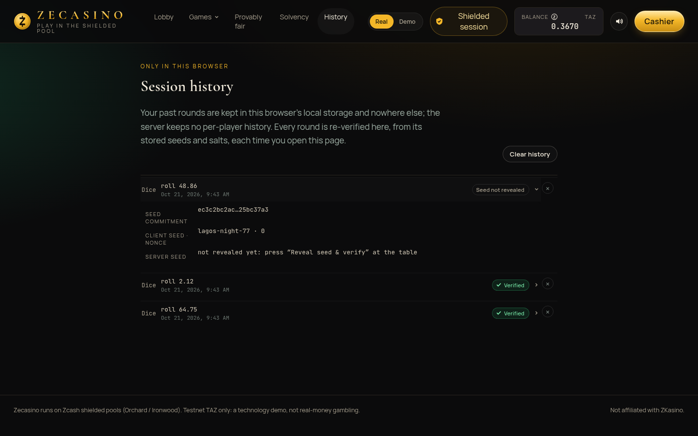 |

Mobile versions are in `screenshots/after/*-mobile.png`.

## Run locally
Requires Rust ≥ 1.89, Node + pnpm. Full steps in [docs/RUN.md](docs/RUN.md).
```sh
cargo build --release -p zecasino-game-server -p zecasino-zec-service
mkdir -p run && cd run
export ZEC_MNEMONIC=$PWD/house.mnemonic ZEC_WALLET_DB=$PWD/zec-wallet.sqlite
../target/release/zecasino-zec-service new-seed
../target/release/zecasino-zec-service init tip </dev/null
export ZEC_INTERNAL_KEY=$(head -c 24 /dev/urandom | od -An -tx1 | tr -d ' \n')
../target/release/zecasino-zec-service serve </dev/null &
ZEC_SERVICE_URL=http://127.0.0.1:3300 ZECASINO_DB=$PWD/zecasino.sqlite ../target/release/zecasino-game-server &
cd ../apps/web && NEXT_PUBLIC_GAME_WS=ws://127.0.0.1:3200/ws pnpm build && pnpm start -p 3100
```
Testnet TAZ: https://faucet.testnet.valargroup.dev

## Demo mode
Every table has a demo toggle with play chips, so you can try all seven games without depositing. Demo chips never touch real balances or the solvency figures. The lobby walkthrough and per-table how-to-play overlays explain each game.

## Tests
- `cargo test --workspace`: 47 tests covering fairness, the ledger, settlement, the address policy and websocket end-to-end runs of each game.
- `node --experimental-strip-types apps/web/scripts/verify-vectors.mts`: the browser fairness code matches the Rust vectors.
- `qa/`: 65 browser play-through checks with two real sessions, including refresh, disconnect, overdraw and server restart mid-round (`qa/RESULTS.txt`).

## Limitations
- Testnet only. It is not audited and not for real money.
- The server is custodial during a session and sees balances, bets and withdrawal destinations, just not who you are.
- Hot-wallet reserves are self-reported. Only the cold reserve is publicly verifiable, so reserve coverage on /solvency reflects that.
- Bankroll is tiny (faucet TAZ), so stakes are small.
- Built on pre-release NU7 librustzcash crates. WebZjs does not work on NU7 yet, so the wallet runs server-side.
- Network-level privacy depends on the user (e.g. Tor). We do not log IPs, but we cannot hide them for you.

## Credits and license
Card faces: Vector Playing Cards (public domain). Sounds: Kenney Casino Audio (CC0). Fonts: Cormorant Garamond, Manrope (SIL OFL). All other art is original. See [ASSETS.md](ASSETS.md).

Code: [MIT](LICENSE). Zecasino is not affiliated with ZKasino or the Electric Coin Company.
